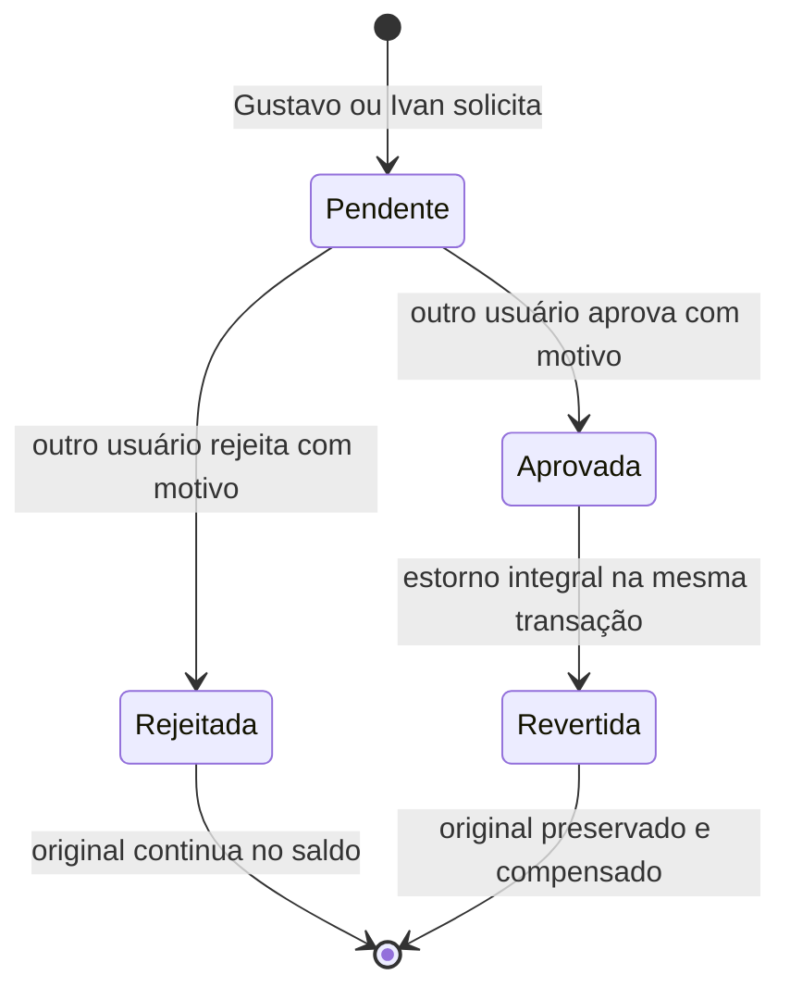

# Primeira entrega — modernização do app-criativaMC

Data: 15/11/2026. Estado: proposta para revisão de Zyra e aprovação do usuário.
Branch local: `codex/modernizacao-supabase`. Nenhuma alteração funcional, migração,
conta, importação, commit, push ou publicação realizada nesta etapa.

## 1. Diagnóstico e evidências

Aplicação estática: sete HTMLs, seis arquivos JavaScript, CSS, manifestos,
service worker e imagens. Não há framework, package.json, infraestrutura de
backend nem testes versionados. Preservar essa estrutura é viável; não há motivo
para reescrever o produto. Os ícones foram inventariados, sem alteração.

Git inicialmente limpo, branch `main`, HEAD `157f8f6` (Sistema inicial gestão de
obras), acompanhando `origin/main` local. Remoto:
`https://github.com/Brandao1974/app-criativaMC.git`.
Nenhum AGENTS.md encontrado no inventário do projeto e nos ancestrais consultados.

| Evidência no código | Diagnóstico | Tratamento proposto |
|---|---|---|
| `js/auth.js:1`, `:29`; guards nas telas e `index.html` | Credenciais fixas públicas e identidade forjável em `usuarioLogado` | Auth individual; autorização no banco |
| `js/obras.js:108` | A simples leitura normaliza e regrava o legado, inventando IDs/datas ausentes | Exportar antes de abrir obras/detalhe; importador independente |
| `js/obras.js:430`, `:481`, `:531` | Caixa atualizado ao inserir, mas não ao excluir | Eliminar escalar do fluxo operacional; somar razão financeiro |
| `js/obras.js:531` | Dois booleanos locais apagam fisicamente o lançamento; não há rejeição, justificativa ou trilha durável | Solicitação e decisão autenticadas no banco |
| `js/obras.js:27` e validações de entrada/custo | Conversão ambígua e valores negativos aceitos por serem truthy | Parser decimal estrito e constraints |
| `js/obras.js:219`, `:289`, `:362`; `caixa.js:79`; `agenda.js:172` | Texto do usuário interpolado em HTML | Nós DOM com textContent; remover handlers inline ao modularizar |
| `js/dashboard.js` | “Lucro” é apenas entradas menos custos; caixa pode mostrar outro valor | Rótulo Resultado de caixa e fonte SQL única |
| `js/agenda.js` | Próxima execução pode ser passada ou finalizada | Próxima futura não finalizada; manter atrasadas visíveis e identificadas |
| `sw.js` | HTML já é network-first; JS é cache-first; skipWaiting imediato e remoção de todos os outros caches da origem | Cache por versão do app, troca coordenada de build, excluir só caches deste app |
| `dashboard.html`, `sw.js` | Chart.js sem versão e instalação dependente da CDN | Versão fixa local; gráfico não deve bloquear indicadores |

Chaves efetivamente utilizadas: `obras`, `caixa`, `usuarioLogado`,
`obraSelecionada`. Exportação deve preservar também chaves desconhecidas.
Dados reais não estão no repositório e não foram acessados no navegador.

## 2. Revisão dos documentos do OpenBot

Foram lidos os quatro SQL, os documentos 05–08, os dois relatórios e o anexo
PRISM em `C:\Users\Joelma\OpenBot\Shared\Projeto-Supabase-app-criativaMC`.
Os originais permanecem intactos. A missão atual prevalece sobre o contrato antigo.

| Documento | Divergência relevante |
|---|---|
| 01-schema / 02-rls | `owner_id = auth.uid()` separa a base; não atende Gustavo e Ivan juntos. DELETE de obra pode apagar histórico por cascade. Não há tabela de solicitações/decisões |
| 02-rls | UPDATE direto em campos de exclusão permite efeito financeiro individual; INSERT em histórico permite eventos fabricados pelo próprio membro |
| 03-dinheiro | Estorno valida obra e tipo, mas não igualdade do valor; permite reversão parcial/excessiva. Exclusão posterior do original ou estorno pode distorcer o par. Trigger de imutabilidade não cobre todos os identificadores/autoria, embora alguns estejam protegidos por GRANT |
| 04-indicadores e anexo | Dizem que categoria não é coletada, mas `adicionarCusto()` já grava `tipo`. Usam current_date do servidor; definir America/Sao_Paulo. Trocar pizza por barras é opcional e não necessário à migração |
| 05-arquitetura | Perde `usuarioCriador`, descarta aprovação pendente e prevê fallback para data atual/status inicial. Descrição vazia proposta falha no CHECK SQL. Rollback com DELETE conflita com proteção financeira |
| 06-integracao | Remove dupla aprovação; upsert de perfil conflita com ausência de INSERT; fala em ausência de atomicidade de status apesar do trigger. CDN/JS com atualização independente pode misturar versões |
| 07-testes | Testa isolamento entre A/B e duplicação entre contas como resultado correto; ambos são incorretos nesta missão. C10: 10.000 entradas de 1 centavo = 10.000 centavos (R$ 100), não 100 centavos |
| 08-login | Visual pode ser reaproveitado, mas remover aprovação é inadmissível. Recuperação precisa de configuração e teste reais, não só tela |
| Relatórios | Sintaxe validada anteriormente não é prova de execução, segurança ou correção. Reexecução de CREATE TABLE IF NOT EXISTS não atualiza estrutura. DDL só é atômico como conjunto se houver transação envolvendo o conjunto |

Não aplicar os SQL antigos em sequência. A revisão de Zyra solicitada na missão
ainda não ocorreu para esta nova proposta; o relatório antigo é dirigido a ela,
não constitui aprovação dela.

## 3. Arquitetura colaborativa proposta

Um projeto Supabase exclusivo e uma base compartilhada. Duas contas Auth
individuais associadas, por administração, aos lugares fixos Gustavo e Ivan.
Nome de exibição e user_metadata nunca concedem permissão. Cadastro público e
login anônimo desabilitados. Um terceiro autenticado sem vínculo continua sem acesso.

`profiles` preserva identidade; `app_membros` autoriza os dois operadores.
Não há workspace/tenant configurável, convites por obra ou papéis adicionais:
isso adicionaria complexidade sem necessidade para esta base exclusiva.
Ambos leem as mesmas obras, movimentos, solicitações, decisões e histórico.

Leituras por RLS. Escritas por operações SQL transacionais com argumentos
restritos. O navegador não escreve diretamente nas tabelas de negócio.
Autor, instante, aprovador e tipo/valor de estorno são definidos pelo servidor.
Funções públicas invoker encaminham a implementação privada definer, com
search_path vazio, nomes qualificados, checagem explícita de auth.uid() e vínculo
ativo. Revogar EXECUTE de PUBLIC/anon e conceder apenas assinaturas necessárias.
Esse privilégio elevado é necessário para escrever sem conceder DML ao cliente;
é uma fronteira que exige teste próprio, pois bypassa RLS.

Modelo relacional e contratos SQL: [MODELO-SQL-REVISADO.md](MODELO-SQL-REVISADO.md).

## 4. Aprovação dupla e correções

Solicitante registra motivo; saldo permanece igual. Somente o outro lugar ativo
pode aprovar ou rejeitar, com justificativa. Solicitação e decisão formam as duas
participações: solicitante não registra uma segunda assinatura em seu pedido.

Bloquear autoaprovação no banco, inclusive via API direta. Uma solicitação
pendente por original. Bloquear o movimento e o pedido com ordem consistente
antes de decidir; decisão e estorno na mesma transação. Repetição da mesma
operação é idempotente; decisão oposta após encerramento falha.

Proposta: exclusão financeira = estorno integral, com original preservado.
Não combinar estorno com filtro que retire o original da soma: isso descontaria
duas vezes. Não haverá soft delete financeiro paralelo. Estornos reduzem as
entradas/custos da categoria original nos indicadores líquidos; não contam como
nova receita operacional quando revertem custo.

Para não permitir que correção contorne a dupla aprovação, a reversão usada
na correção passa pelo mesmo pedido. Após a aprovação, um lançamento corrigido
pode ser criado e vinculado ao original; não se edita valor já registrado.
Pedido rejeitado pode ser seguido de novo pedido justificado; o anterior fica
no histórico. Exclusão física de obra não existe no app atual e não será adicionada.

## 5. Preservação e importação

Plano detalhado e exportador preparado: [PRESERVACAO-E-TESTES.md](PRESERVACAO-E-TESTES.md).
Antes de migrar, obter exportações do navegador/perfil/origem de cada operador
(incluindo instalações PWA). Mesmo login não implica sincronização do legado.
Não importar duas bases distintas sem comparar conflitos e confirmar fonte canônica.

Preservar os valores brutos de localStorage como strings, JSON original sem
normalização, hash SHA-256 e arquivo privado fora do Git. Nunca exportar dados
reais para repositório público. Não apagar nem regravar o legado automaticamente.

Importação será uma ferramenta administrativa local, com acesso temporário
aprovado, não uma RPC permanente disponível aos operadores. Manifesto de
identidades por origem e hash evita duplicação também entre importadores;
conteúdo diferente para a mesma identidade exige resolução, não DO NOTHING cego.
Histórico e nomes legados são preservados como evidência não verificada;
assinaturas booleanas antigas não equivalem a decisões Auth. Uma pendência
legada exige nova solicitação confirmada pelo operador identificado, sem efeito
financeiro automático. Não inventar data/autor/lançamento para satisfazer constraints.

## 6. Implementação em etapas após revisão/aprovação

| Etapa | Entrega | Critério de saída |
|---|---|---|
| 1 | Aprovar arquitetura, organização, região/custo e regras de reversão | Parecer Zyra + aprovação registrada; autorizações remotas separadas |
| 2 | Migrações versionadas, funções e testes em PostgreSQL local isolado | RLS, concorrência, autoaprovação e igualdade de estorno comprovadas |
| 3 | Exportador e conversor; ensaio com fixtures e depois cópias autorizadas | Original preservado, relatório completo, repetição sem duplicar |
| 4 | Auth e camada dados/dinheiro; adaptar as sete telas | Dois usuários no mesmo dataset; visual/navegação preservados; XSS tratado |
| 5 | PWA por build, versão fixa de dependências e recuperação de sessão | Sem mix de builds; Auth/API/financeiro fora do Cache Storage; erros explícitos |
| 6 | Projeto exclusivo e contas reais, após autorização específica | Configuração Auth/redirects aprovada, vínculo dos dois operadores validado |
| 7 | Migração remota aprovada, importação autorizada e reconciliação | Contagens, entradas, despesas e saldos conferidos; divergências aceitas |
| 8 | Revisão final, commit/push/merge/publicação após aprovação | Testes completos, Pages verificado, recuperação ensaiada |

Na UI: manter HTML/CSS e navegação; usar ES modules, client Supabase com versão
fixa e chave publishable pública. Remover credenciais locais. Guard aguarda
Auth e vínculo; autorização real permanece no banco. Erro de rede não deve
virar lista vazia nem logout forçado por qualquer 403. Troca de usuário limpa
memória/DOM; não limpa backup legado. Sem fila de escrita offline neste escopo.
Cache de assets versionado; atualização coordenada entre abas com aviso e
recarregamento após encerrar operação. Remover somente caches deste app e não
os caches de outros projetos do mesmo domínio GitHub Pages.

Migrações finais serão geradas com CLI após verificar versão/--help, transações
e histórico/checksum. Reaplicar versão já aplicada deve ser no-op verificado;
drift deve falhar. Evoluções ganham nova migração, sem sobrescrever a aplicada
ou usar IF NOT EXISTS para esconder estrutura incompatível.

## 7. Situação dos acessos

GitHub: connector autenticado como Brandao1974; repositório público, default
branch `main`, permissões pull/push/admin informadas pela API. Leitura remota do
trecho de exclusão em `main` confirmou o defeito local. Permissão declarada não
prova push executado; nenhum push foi tentado. `git ls-remote` pelo shell falhou
por conexão de rede; o HEAD remoto completo ainda precisa ser comparado antes
de commit/integração. A criação da branch local foi concluída após liberação do sandbox.

Supabase: list_projects respondeu com sete projetos; seis INACTIVE e um
ACTIVE_HEALTHY (referência `xkkidopvhnuhbszktzej`).
Nenhum chamado app-criativaMC. Inventário recebido:

| Nome retornado | Estado | Região |
|---|---|---|
| ildebrando.s@gmail.com's Project | INACTIVE | sa-east-1 |
| Temple Slot Machine | INACTIVE | sa-east-1 |
| EmissorFiscal | INACTIVE | sa-east-1 |
| Reverbera | INACTIVE | ca-central-1 |
| tuvelio-licensing | INACTIVE | us-east-1 |
| cafeteriasemear.app | INACTIVE | sa-east-1 |
| CalculoFrete — ref. xkkidopvhnuhbszktzej | ACTIVE_HEALTHY | sa-east-1 |

Organização presente no retorno: `uotwkhgkruzduvtvpvaw`.
Proposta: novo `app-criativaMC` em `sa-east-1` (São Paulo), PostgreSQL padrão,
sem reutilizar projetos existentes. A organização precisa ser confirmada pelo
usuário antes de consultar a cotação de criação, conforme contrato da ferramenta.
Plano, cota, disponibilidade e custo ainda não verificados. Listagem confirma
leitura da conta, não autorização/capacidade de criação ou execução de DDL.

GitHub Pages: tentativa de leitura pelo navegador web de pesquisa falhou;
publicação atual não foi validada visualmente nem funcionalmente. Não houve deploy.

## 8. Aprovações e decisões

Regras já decididas pela missão: base compartilhada, contas distintas,
proibição de autoaprovação e efeito financeiro somente após decisão do outro.
Não pedir nova decisão para substituir isso por bases privadas/conta única.

Para revisão de Zyra: confirmar razão imutável, reversão integral com aprovação
também para correções, ausência de DELETE físico, política de pendências legadas
e matriz de autorização. Saldo negativo continua permitido (comportamento atual).
Proposta para indicador em andamento: manter inicialmente `status != Finalizada`
para preservar regra existente; mudança para apenas três status exige decisão
explícita, sem ser tratada como correção obrigatória da persistência.

Depois do parecer e da aprovação: autorização de implementação local.
Antes de criar projeto: confirmar organização, região e orçamento/cotação.
Antes de contas/configuração Auth: confirmar e-mails reais e redirects/SMTP.
Antes de importar: exportações, fonte canônica e relatório de reconciliação aceito.
Antes de publicação: testes concluídos e autorização de commit/push/merge.

Nenhuma mensagem foi enviada a Zyra ou terceiros. Este pacote está preparado
para a revisão; não presume acesso a uma sessão dela nem simula sua aprovação.

## 9. Validação e limites

Executados: inventário/leitura de código e documentação, estado Git, metadados
GitHub, listagem Supabase e consulta à documentação oficial. Reprodução local
com dados sintéticos e análise sintática do modelo constam no arquivo de evidências.
Não executados: login real, RLS em PostgreSQL, APIs financeiras, concorrência real,
importação real, testes das páginas em navegador e publicação. Nenhuma dessas
verificações deve ser marcada como aprovada antes da implementação.

Referências consultadas em 15/11/2026:
[RLS e security_invoker](https://supabase.com/docs/guides/database/postgres/row-level-security),
[funções e privilégios](https://supabase.com/docs/guides/database/functions),
[changelog](https://supabase.com/changelog.md).
O changelog inclui mudança de CLI em novembro; confirmar comandos na versão
instalada antes de criar as migrações. Não foi instalado SDK ou CLI nesta etapa.
